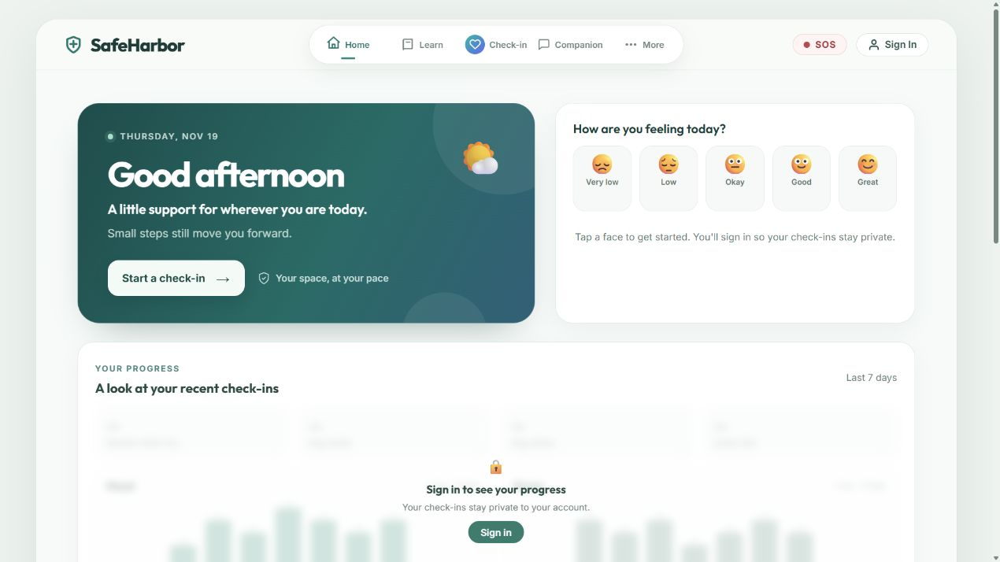

# SafeHarbor

**Wellness education, substance-use prevention, and practical support for teens and young adults.** SafeHarbor brings learning resources, guided reflection, coping exercises, and paths to human support into one calm web app.

SafeHarbor is an educational project. It does not diagnose, treat, or replace a trusted person, qualified professional, or emergency service.

[Open SafeHarbor](https://safeharbor2.vercel.app/) · [View the source on GitHub](https://github.com/danygam123/safeharbor2)



## What you can do

- **Learn:** Browse a curated library, filter by audience and topic, bookmark resources, and track what you have explored in this browser.
- **Check in and reflect:** Record mood, stress, coping strategies, and optional notes in a guided daily check-in. Signed-in users can also keep private journal entries and goals.
- **Practice:** Try guided breathing, urge-surfing, grounding, and thought-reflection exercises. Notes entered during practice are not saved by the exercise flow.
- **Practice a response:** Walk through a short overdose-response scenario based on [CDC guidance](https://www.cdc.gov/stop-overdose/response/).
- **Find support:** Open national U.S. helplines and treatment directories, or optionally search for nearby services. Call **911** for immediate danger or a suspected overdose. In the U.S., call or text **988** for emotional crisis support.
- **Talk with the AI Companion:** Have an educational conversation with an AI tool. It is not a clinician or emergency service.

## How it works

SafeHarbor is a static HTML, CSS, and vanilla JavaScript app with no frontend build step or npm dependencies. Supabase provides authentication and account storage. A Vercel serverless function at `api/chat.js` sends Companion requests to Google Gemini while keeping the Gemini API key on the server.

The app also loads the Supabase browser client from jsDelivr and fonts from Google Fonts. Optional place search uses OpenStreetMap's Nominatim service to look up a typed city or ZIP code, then displays map results through Google Maps. Each provider has its own terms and privacy practices.

## Run locally

### Browse the app

Install Python 3, clone the repository, and from its folder run:

```sh
python -m http.server 8000
```

Open [http://localhost:8000](http://localhost:8000). The public learning, practice, scenario, and support pages can be browsed without signing in. Authentication and stored personal features need a Supabase project; Companion requests need the Vercel function and a Gemini key.

### Set up Supabase

1. Create a Supabase project.
2. Run [`migrations/001_initial_schema.sql`](migrations/001_initial_schema.sql) in the Supabase SQL Editor.
3. Put the project URL and **anon/public** key in [`config.js`](config.js). These values are browser-visible; never put a Supabase `service_role` key there.
4. Add `http://localhost:8000` and your deployed site to Supabase Authentication's allowed redirect URLs.
5. Create an account and confirm the email if confirmation is enabled.

The migration enables Row Level Security for profiles, check-ins, journal entries, and goals. It is designed as initial setup and does not drop existing tables, columns, or records. Review it before applying it to an existing project.

### Run the Companion locally

The static Python server cannot run Vercel functions. Install Node.js and the Vercel CLI, then run `vercel dev` in the repository. Set `GEMINI_API_KEY` in the Vercel project's Development environment (or its documented local environment workflow), restart `vercel dev`, and open the URL it prints.

| Server variable | Required | Use |
| --- | --- | --- |
| `GEMINI_API_KEY` | Yes, for Companion | Authenticates requests made by `api/chat.js` |
| `GEMINI_MODEL` | No | Overrides the default Gemini model |
| `GEMINI_FALLBACK_MODEL` | No | Overrides the fallback model |

Never put a Gemini key in browser code, `config.js`, or a committed environment file. `.gitignore` excludes local `.env` files and Vercel project state.

## Deploy

To deploy your own copy, import the GitHub repository into Vercel. The project is a static site plus the `api/chat.js` function, with no frontend build command. Set `GEMINI_API_KEY` and any optional model settings in Vercel's environment settings, configure Supabase's allowed redirect URLs, and deploy. The public Supabase project values are configured in `config.js`; do not put private keys there.

## Privacy and safety

- **Stored in Supabase:** signed-in account profile, check-ins, journal entries, and goals. Row Level Security limits ordinary users to their own records. Project operators with privileged database access may be able to access stored account data.
- **Stored in this browser:** bookmarks, explored-resource progress, learning checklist progress, selected audience, Companion character preference, and goals. Goals are mirrored to Supabase while signed in. Browser data is not synced across devices.
- **Sent for Companion replies:** the current chat and recent conversation context (up to 40 messages) goes through SafeHarbor's Vercel API to Google Gemini. The selected Companion name is also sent as a presentation preference. Journal entries and check-ins are not automatically included, and SafeHarbor does not save chat transcripts in its Supabase tables. Hosting and AI providers may process requests under their own terms.
- **Sent for optional place search:** a typed city or ZIP code goes to OpenStreetMap Nominatim. If you choose device location, coordinates are used in the Google Maps search. The feature does not run until you request a search.
- **Account deletion:** **My Account → Delete My Account & Data** deletes the signed-in Supabase account and its linked records, then clears this site's browser storage. Deletion is permanent.

SafeHarbor is not medical advice, treatment, diagnosis, or therapy. The AI Companion may be incorrect and cannot monitor you or contact help. If someone may be overdosing or is in immediate danger, call **911**, follow the dispatcher, and stay with the person. For emotional crisis support in the U.S., call or text **988** and consider reaching a trusted person nearby. Nearby search results come from third parties and may be incomplete or out of date.

## Contributing

There is no automated test suite. Before opening a change, check JavaScript syntax with `node --check` on the edited JavaScript files and run `git diff --check`. Keep health guidance sourced, preserve clear emergency directions, and never include private keys, Supabase service-role credentials, or user data in a contribution.

## Sources and acknowledgements

The resource library links to educational material from SAMHSA, NIDA, the 988 Lifeline, CDC, ACF, NAATP, NEXT Distro, and Overdose Lifeline. The Learn page also links to Drug Policy Alliance, DanceSafe, and TripSit for further reading. These links do not imply partnership, endorsement, or affiliation. Refer to each organization for its current information.

The app uses the Supabase JavaScript client distributed through jsDelivr and the Inter and Outfit typefaces from Google Fonts. These external projects and services retain their own terms and licenses.

## License

The [MIT License](LICENSE) applies to original SafeHarbor project source code in this repository. It does **not** cover the four bundled PNG app icons: `apple-touch-icon.png`, `icon-192.png`, `icon-512.png`, and `icon-maskable-512.png`. Their provenance has not been confirmed, and this license grants no rights to reuse those images. Review the license scope before reusing any assets.
